# PPI_PDB_Scrapper

> **About this project.** PPI_PDB_Scrapper is an independent, personal project.
> I conceived it and developed it by hand over 2025 and early 2026, to have a
> reliable source of protein–protein interface structures for training models
> related to protein function. Once the method was mature, I audited it in
> depth with Claude and rebuilt it as a reproducible Snakemake workflow, so that
> the whole dataset can be regenerated from a list of PDB IDs and a single
> configuration file. I am now sharing it with the community.

A reproducible methodology to scrape **protein–protein interfaces (PPIs) from the
Protein Data Bank** and turn them into a curated, non-redundant dataset for
machine learning. It combines PDBe-PISA interface energetics with structural
quality control, physicochemical filters, descriptive analysis, MMseqs2
homology clustering, leakage-free train / validation / test splits and hard
negatives. The whole workflow is orchestrated with Snakemake (Python + R) and
driven by a single configuration file.

Starting from any list of PDB IDs exported from the RCSB Advanced Search, it:

1. downloads the PISA interface analysis of every entry from PDBe and keeps the
   protein–protein interfaces as candidate chain pairs;
2. downloads only the biological-assembly mmCIF files those pairs need, plus
   entry metadata (method, resolution, R-free) from the RCSB Data API;
3. annotates every pair with chain sequences, coverage, homo/hetero status and
   experimental quality, with descriptive statistics and plots of every variable;
4. applies **crystallographic and physicochemical QC** (method, R-free,
   coverage, chain length, buried interface area, PISA ΔiG P-value) and
   **structural QC** in the coordinates (non-standard residues, real atomic
   contacts between the two chains);
5. clusters all chains with MMseqs2 at eight identity thresholds (98–40 %) by
   connected components, so that cluster-based splits do not leak homologues;
6. prunes redundancy, builds a three-level test set (C1 train-like, C2 new pairs
   of known proteins, C3 unseen proteins) and cluster-aware train/val splits;
7. adds **hard negatives**: chains of the same complex that are not in contact;
8. audits the homology leakage between training and every evaluation set.

This is version 1 of PPI_PDB_Scrapper. It succeeds the working versions
PPI_PDB_Scrapper Seq5–Seq8 (2025–2026); [docs/MIGRATION.md](docs/MIGRATION.md)
describes how this version relates to them and which bugs were fixed on the way.

## A full run

Validation run of 2 November 2026 on 164,000 X-ray entries (resolution ≤ 3.0 Å),
on a laptop under WSL2 (20 cores, 14 GB RAM):

| Stage | Result |
|---|---|
| PISA (step 01–02) | 245,760 assemblies, 564,350 interfaces → **204,078 candidate pairs** from 69,581 entries |
| Structures (step 04) | 93,029 assembly mmCIF files, 0 failed downloads |
| Quality filter (step 07) | 152,106 pairs |
| Structure checks (step 08) | 141,523 pairs (33,641 unique chain sequences) |
| Redundancy pruning (step 10) | 43,164 pairs |
| Final dataset | **41,837 train/val pairs** (37,652 / 4,185 in `split_c90`), **700 test pairs**, **717 hard negatives**, from 29,164 entries |
| Leakage audit (step 14) | **0 leaks** in the 8 audited sets |
| Time | 8.8 h: PISA download 6 h 03 min, mmCIF download 1 h 22 min, everything else ~1.4 h |
| Disk | `raw/` 27 GB, `interim/` 1.3 GB, `processed/` 129 MB |

Downloads take 84 % of the time; once `raw/` exists, changing a threshold
reruns only the affected steps (minutes). In the final dataset 74.9 % of the
train/val pairs are *gold* (P-value < 0.2) and 74.6 % are homodimers.

## Pipeline

Python steps do the heavy extraction (downloads, JSON and mmCIF parsing,
geometry, clustering); R steps take the data-analysis decisions (filters,
pruning, splits).

| Step | Script | What it does | Main output |
|---|---|---|---|
| 01 | `01_download_pisa.py` | Reads the ID lists; downloads PISA JSON from PDBe | `raw/pisa/` |
| 02 | `02_parse_pisa.py` | One row per protein pair in each PISA interface | `02_master_pisa.csv` |
| 03 | `03_select_assemblies.R` | Restricts to the ID list; lists the assemblies needed | `03_needed_pairs.csv` |
| 04 | `04_download_structures.py` | Downloads the needed assembly mmCIF files; entry metadata from the RCSB Data API | `raw/assemblies/`, `04_entry_metadata.csv` |
| 05 | `05_audit_downloads.py` | Checks that every needed file is on disk | `05_audit_downloads.json` |
| 06 | `06_enrich_mmcif.py` | Sequences, coverage, homo/hetero, method, resolution, R-free | `06_enriched.csv` |
| 07 | `07_quality_filter.R` | Descriptive analysis + quality filter + gold/silver tier | `07_quality_filtered.csv` |
| 08 | `08_check_structures.py` | Drops chains with non-standard amino acids and pairs without atomic contacts | `08_checked.csv` |
| 09 | `09_cluster_chains.py` | MMseqs2 chain clustering at 98–40 % identity (connected components) | `09_clustered.csv` |
| 10 | `10_prune_redundancy.R` | Exact-duplicate soft cap + pruning in `pair_cluster_98` | `10_pruned.csv` |
| 11 | `11_build_test_set.R` | Test set: C1 (train-like), C2 (new pairs), C3 (unseen proteins) | `processed/test.csv` |
| 12 | `12_trainval_splits.R` | Cluster-aware train/val splits and family weights | `processed/trainval_splits.csv`, `processed/validation.csv` |
| 13 | `13_hard_negatives.py` | Non-contacting chain pairs of the same assembly, assigned to splits | `processed/hard_negatives.csv` |
| 14 | `14_leakage_audit.py` | Homology leakage of each test bucket and of validation against training | `reports/14_leakage_audit.json` |

`analysis/clustering_stats.R` is an optional exploratory report on the clusters
(`snakemake --cores 1 clustering_stats`).

```mermaid
flowchart LR
  ids[RCSB ID lists] --> s01[01 PISA download] --> s02[02 parse PISA] --> s03[03 select assemblies]
  s03 --> s04[04 mmCIF download] --> s05[05 audit] --> s06[06 enrich]
  s06 --> s07[07 quality filter] --> s08[08 structure checks] --> s09[09 MMseqs2]
  s09 --> s10[10 prune] --> s11[11 test set] --> s12[12 train/val splits] --> s13[13 hard negatives]
  s13 --> s14[14 leakage audit]
  s12 --> s14
```



## Installation

```bash
conda env create -f environment.yml
conda activate ppi_pdb_scrapper
```

The environment provides Python 3.11, R ≥ 4.3 (dplyr, tidyr, data.table, yaml),
MMseqs2, Snakemake and graphviz.

## Usage

1. Run a query in the [RCSB Advanced Search](https://www.rcsb.org/search/advanced),
   click **Download IDs** and put the `.txt` file(s) in `pdb_ids/`. The query
   decides the scope of the dataset (method, resolution, date…).
2. Review the parameters in `config/config.yaml` (every threshold lives there).
3. Run the pipeline from the repository root:

```bash
snakemake -n              # dry run: list the steps that would run and why
snakemake --cores 8       # run everything
```

Useful Snakemake commands:

```bash
snakemake --cores 8 --until quality_filter           # stop after step 07
snakemake --cores 8 --forcerun download_structures   # rerun a step (e.g. retry failed downloads)
snakemake --cores 8 --config cfg=config/test.yaml    # use another config file
snakemake --cores 1 clustering_stats --config cfg=config/test.yaml  # a target goes before --config
snakemake --cores 1 --touch --until check_structures # mark steps 01-08 as up to date without running them
snakemake --dag | dot -Tsvg > dag.svg                # draw the workflow
```

Snakemake only reruns what is missing or out of date. Each rule receives the
config sections it uses as `params` and declares its script (and the shared
`common.py` / `common.R`) as inputs, so changing a section of the config (for
instance `quality_filter`) or editing a script repeats that step and everything
downstream of it. Editing `scripts/common.py` therefore reruns the whole
pipeline, downloads included; after a change that does not affect the early
steps, `snakemake --touch --until <rule>` marks them as up to date. All
parameters live in the YAML file: `--config` only accepts `cfg=<file>`, and
`--configfile` is not used. A config can inherit from another one with
`base: config/config.yaml`. Every script can also be run by hand from the
repository root, e.g. `python scripts/06_enrich_mmcif.py --config config/config.yaml`
or `Rscript scripts/07_quality_filter.R config/config.yaml`.

### Quick test

`config/test.yaml` runs the whole pipeline on the 1,500 IDs in `tests/pdb_ids/`
(about 0.5 GB of downloads, ~6 minutes) into `data_test/`:

```bash
snakemake --cores 8 --config cfg=config/test.yaml
python tests/check_outputs.py --config config/test.yaml   # consistency and leakage checks
```

`tests/check_outputs.py` runs 21 checks on the final tables (sizes, duplicates,
test/train overlap, lengths, contacts, labels and the 8 leakage sets) and
fails if any of them does not hold.

## Methodology and parameters

Every threshold is in `config/config.yaml`. Most of them are a matter of what
the dataset is for; the notes below explain what each group means and why the
defaults are what they are.

**PISA pre-filter (`pisa`, step 02).** PISA reports `interface_area` as the
solvent-accessible area buried *per side* (half of the total buried surface),
so 800 Ų means about 1,600 Ų buried in total, above the typical range of
crystal-packing contacts. `p_value` is PISA's ΔiG P-value: the probability of
finding a more hydrophobic patch of the same size by chance; values below 0.5
suggest an interaction-specific interface. PISA-lite does not provide the
complexation significance score (CSS) of classic PISA, so specificity relies
on area, P-value and solvation energy, with thresholds chosen by the pipeline.
These two values are only a pre-filter (they decide which structures are
downloaded); the final thresholds are set in `quality_filter` and can only be
stricter. Only the assemblies an entry has today are used
(`only_current_assemblies`): the PDBe dump can keep assemblies removed in later
revisions, and entries that RCSB no longer serves are listed as obsolete. PDBe
recomputes PISA when an entry is revised, so a rerun of step 01 downloads again
any file that PDBe has updated since the previous run.

**Quality filter (`quality_filter`, step 07).** Experimental method, R-free,
optional maximum resolution, minimum coverage of both chains, chain length
range, interface area range and P-value. Method and resolution are often
already restricted by the RCSB query (the reference dataset uses X-ray
structures up to 3.0 Å); cryo-EM entries are excluded by design because they
have no R-free. `coverage_metric` chooses between `coverage` (resolved / SEQRES
residues) and `internal_coverage` (resolved residues between the first and the
last resolved one): with the latter, disordered expression tags and tails are
not penalised, only internal gaps (in the full run it would rescue 90 % of the
chains that fail on `coverage`). An optional cut on solvation density
(`solvation_energy / interface_area`) is available but disabled by default.
`min_chain_length` (at least 40 residues by default) keeps peptides out:
besides being a different problem, chains this short cannot reach a significant
MMseqs2 E-value, so near-identical peptides would escape the homology
clustering of step 09 and its leakage guarantees. `max_chain_length` (600) is
often limited by the model you plan to train. Homo/hetero pairs are defined by
the same entity or a sequence identity of at least `enrichment.homo_similarity`,
measured on a global alignment over the shorter chain, so a truncated construct
of the same protein counts as homo. Step 07 also writes descriptive statistics
of every variable to its log and histograms to `reports/07_quality_filter_plots.pdf`.

**Structure checks (`special_residues`, `contacts`, step 08).** Only the
polymer residues of each chain are considered (ligands, waters and free amino
acids that share the chain ID are ignored), in the first model and the A
conformer. A chain is dropped if it has a polymer residue that is not one of
the 20 standard amino acids, not in `allowed` and not in `ignore` (terminal caps
ACE and NH2 by default). The default is conservative: only the selenium
residues used for phasing or naturally present (MSE, SEM, SEC) are allowed. In
the full run the excluded chains (5.7 %) carry cysteine modifications that are
usually crystallisation artefacts (CSO, CSD, CSS, CME), catalytic or cofactor
lysines (KCX, LLP), GFP-like chromophores, N-terminal modifications (PCA),
post-translational modifications, D-amino acids or unknown residues (UNK); add
any of them to `allowed` if they are acceptable for your use. Every pair must
also have at least `min_residue_contacts` residue pairs with polymer heavy atoms
within `cutoff` Å (a KD-tree search); this catches PISA interfaces that cannot
be mapped onto the structure. In the full run no pair failed it.

**Clustering (`clustering`, step 09).** Chains are clustered at eight
identity thresholds (98 to 40 %); the clusters define the pruning groups
(98 %), the validation splits (90, 80, 60 %), the C2 test buckets (pair
clusters at 70 and 80 %) and the C3 buckets (chain clusters at 40 and 50 %).
The default method, `connected_components`, runs one all-vs-all MMseqs2 search
and links two sequences when their identity is above the threshold with the
required alignment coverage in either search direction (the same rule as the
leakage audit); clusters are the connected components (single linkage). Two
sequences of different clusters then never have an MMseqs2 hit that meets the
linking criterion, so cluster-based splits do not leak homologues *as long as
the search sees every hit*: `max_seqs` must exceed the number of prefilter
candidates of the most populated family (antibody chains need thousands). The
price is that large families merge into big clusters (at 40 %, the largest
component of the full run holds 15 % of the sequences), and that two members
of a cluster can be less similar than the threshold through a chain of links.
The alternative `set_cover` (MMseqs2 `cluster`, used by the working versions)
only guarantees that every member is similar to its representative: members of
different clusters can still be similar above the threshold, which left about
3 % of the earlier validation pairs and of its unseen-protein test chains with
a homologue in training. Other approaches can be preferable depending on the
question: greedy incremental clustering (CD-HIT), graph-partitioning methods
that balance split sizes while removing cross-split homology (GraphPart),
structure-based clustering (Foldseek, TM-score), which also catches remote
homologues below ~30 % sequence identity, or splits by domain classification
(CATH, SCOP, ECOD).

**Redundancy (`pruning`, step 10).** Many entries contain several copies of
the same complex (non-crystallographic symmetry, several assemblies), and close
homologues appear across entries. The step works in two stages:

1. *Identical sequence pairs* are capped, across the whole dataset, to the best
   `exact_K_homo` / `exact_K_heter` rows (ranked by coverage, P-value,
   interface area, R-free, resolution and solvation energy). In the full run
   this stage removed 63 % of the rows (141,523 → 52,085).
2. *Pair clusters* (`pair_key`, by default `pair_cluster_98`: both chains in
   the same 98 % clusters) with more than `activate_n` rows are reduced to
   `K_redund_*` rows when their interface areas are almost identical (range
   within `area_range_pct_thr` % of the mean) or to `K_var_*` rows spread over
   interface-area bins otherwise (52,085 → 43,164).

Point mutants and variants with a few substitutions are different sequence
pairs, so the first stage keeps them, but they share a 98 % pair cluster, so
the second stage keeps only a few of them per complex. If you want mutant
series (e.g. to learn the effect of substitutions on the interface), raise
`activate_n` (a very large value disables the second stage) or the `K_*`
values; for a strictly non-redundant set, set every `K` to 1.
`compare_pair_cluster_95` additionally prints a broader pruning in
`pair_cluster_95` for comparison.

**Test set (`test_set`, step 11).** The external test set has three kinds
of buckets, built in this order and removed from the training pool:

- **C3, unseen proteins** (`n_c3_40`, `n_c3_50`): pairs whose two chains belong
  to rare chain clusters at 40 % (then 50 %) identity. Every row of the
  training pool that contains one of those clusters is removed, so both
  proteins are new to the model at that identity. The candidates are the
  `c3_mult` × N rows of the rarest families, sampled within length and
  interface-area strata.
- **C2, new pairs of known proteins** (`n_c2_c70`, `n_c2_c80`): one pair per
  pair cluster at 70 % (80 %) identity, where both chains also appear in other
  pairs; the whole pair cluster and the identical sequence pairs are removed
  from training, and each chain cluster (98 %) is used at most
  `c2_chain_cap_98_global` times. `c2_pick` chooses the pair that represents its
  cluster: `random` (default; quality similar to training), `best` or `worst`
  (the working versions used `worst`, which gave a test set of lower coverage
  than the training data and mixed structure quality with novelty).
- **C1, train-like** (`n_c1`): pairs from the most populated families, sampled
  within strata; only the selected rows are removed, so close homologues remain
  in training. C1 measures performance where the model has seen the most
  examples (an optimistic bound) and is expected to show leakage in step 14.

Every bucket is forced to `homo_frac` homodimers (0.5 by default, while about
75 % of the pairs are homo), so report metrics separately for homo and hetero
pairs. C1 and C3 are stratified by length and interface-area bins
(`nbins_len`, `nbins_area`) in proportion to their candidates, so they follow
the distribution of those candidates rather than that of the training set (C3
interfaces are smaller on average); C2 is only balanced for homo/hetero.

**Train/validation splits (`splits`, step 12).** The remaining pool is split
three times, by pair cluster at 90, 80 and 60 % identity (`split_c90`,
`split_c80`, `split_c60`), sending `val_frac` of the rows to validation with
the same homo/hetero proportion. Splitting by pair cluster means that a
protein A can appear in training and validation, but no training pair joins a
homologue of A with a homologue of its partner at the scheme's identity: the
validation sets measure generalisation to new pairs, increasingly distant from
the training pairs. The three schemes are independent splits, so train one
model per scheme to draw that curve. `family_weight_c90` (1/√ of the size of
the pair cluster at 90 % in training) can be used to down-weight large
families with `split_c90`. `validation_split` selects the scheme exported as
`validation.csv`.

**Hard negatives (`hard_negatives`, step 13).** Two protein chains of the
same biological assembly with no PISA interface between them. Pairs of
identical sequences are excluded by default (a copy of a protein not touching
another copy usually contradicts a homo interface elsewhere in the complex). A
negative is dropped if its pair of chain clusters at `conflict_level` (40 % by
default) has a PISA interface in any downloaded assembly, because homologues
above ~30–40 % identity tend to interact in the same way (Aloy et al.,
*J. Mol. Biol.* 2003); it is also dropped if it fails the quality thresholds of
step 07 (except the interface ones), if a chain has forbidden residues (same
rules as step 08) or if the chains are closer than `min_distance` Å
(`max_distance`, if set, keeps only near-miss pairs). One negative is kept per
entry and sequence pair, at most `max_per_pair_cluster` per pair cluster
(`pair_cluster_key`, 98 % by default) across entries, so that complexes
deposited many times do not dominate, and at most `max_per_entry` per entry, so
that ribosomes and capsids do not either. Each negative gets a split for every
scheme of step 12 (`split_c90`, `split_c80`, `split_c60`): test if a protein
appears only in the test set or in a held-out C3 cluster, validation if a
protein appears only in validation, training otherwise; negatives of the same
pair cluster at `family_level` (40 %, the conflict level) all go to the most
restrictive of those sets, so a family is never split between training and
evaluation. The step stops if a PISA file is missing, since that would hide
contacts. A negative means "no evidence of contact in the downloaded
structures", not a proven non-interaction.

**Leakage audit (step 14).** Chains are searched in both directions with the
identity, coverage and E-value criteria of step 09: every test bucket against
the training and validation positives, the validation set of each scheme
(`split_c90`, `split_c80`, `split_c60`) against its training positives, and the
hard negatives of the test set against the training and validation positives
and the non-test negatives. `reports/14_leakage_audit.json` gives the number
of leaks of each set at its design threshold (chain level for the
unseen-protein C3 buckets, pair level for C2, validation and hard negatives)
and `reports/14_leakage_by_threshold.tsv` the full picture at every threshold.
With connected components all of them should be zero; `tests/check_outputs.py`
fails otherwise. C1 is train-like by design and has no design threshold. The
audit uses the same tool and criteria as the clustering, so it is a
consistency check: it cannot see remote homologues below 40 % identity or a
single shared domain in multidomain proteins.

## Outputs

All files are written under `data/` (configurable with `data_dir`):

```
data/
├── raw/         PISA JSON and assembly mmCIF files (gzipped), with download manifests
├── interim/     tables of steps 01–11
├── processed/   test.csv, trainval_splits.csv, validation.csv, hard_negatives.csv
├── reports/     audits, parse errors, quality-filter plots
└── logs/        one log per step
```

Each row of the final tables carries the PISA interface metrics (area,
P-value, solvation and stabilisation energy, hydrogen bonds, salt bridges) and
the assembly-level metrics, what was measured in the structure (sequence,
length, coverage and internal coverage of each chain, identity between them,
residue and atom contacts, minimum inter-chain distance, special residues), the
entry metadata, the chain and pair cluster IDs at the eight thresholds, the
test bucket or the three split columns, the gold/silver `tier` and
`family_weight_c90`.

Disk space: about 25 KB of PISA JSON and 0.27 MB of mmCIF per assembly, i.e.
~0.5 GB for the 1,500-ID test and 27 GB for 164,000 IDs.

## Known issues

- `number_interface_residues` is copied from PISA-lite, where it is the length
  of the residue list of one molecule (the whole chain), not the number of
  interface residues. No step filters on it, but do not use it as a feature;
  the real count is the number of residues with `buried_surface_areas` > 0.
- With `quality_filter.exptl_method: null`, step 07 disables the method filter
  but step 13 keeps no negatives (it compares with `None`).
- The homo filter of step 13 only removes identical sequences, not the
  `is_homo` definition of step 06 (the conflict filter usually catches the rest).
- The hard negatives come from few large complexes (35 % from proteasomes in
  the full run, 30 families at 40 % among the 132 test negatives) and none is a
  homodimer: evaluate them per family and against hetero positives only.
- Steps 01–04 query live services: a rerun of those steps can download updated
  PISA files and metadata while keeping older mmCIF files. To freeze a dataset,
  keep `data/raw/` and `data/interim/` and do not rerun steps 01–04.

## Troubleshooting

- **"Output … has older modification time than input … clock skew" (WSL2).**
  The WSL2 clock can jump back after the computer sleeps. Run the same
  `snakemake` command again; it resumes from the step that stopped.
- **Failed downloads.** Each file is retried `download_retries` times. Steps 01
  and 04 stop if more than `max_failed_fraction` of the files still fail (run
  the same command again to retry them; files already on disk are kept) and
  report the remaining failures in their manifests.
- **Stopping a run.** On SIGTERM, Snakemake lets the running job finish (which
  can take hours during a download) and exits without losing anything; Ctrl-C
  stops at once and removes the incomplete outputs of that step.

## Data sources

- **RCSB PDB** — assembly mmCIF files (`files.rcsb.org`), the Data API
  (`data.rcsb.org`, current assemblies and entry metadata) and the Advanced Search.
  Burley et al., *Nucleic Acids Res.* (2023).
- **PDBe PISA** — interface and assembly analysis
  (`ftp.ebi.ac.uk/pub/databases/msd/pdb-assemblies-analysis`).
  Krissinel & Henrick, *J. Mol. Biol.* 372, 774–797 (2007).
- **MMseqs2** — Steinegger & Söding, *Nat. Biotechnol.* 35, 1026–1028 (2017).
- **Biopython** — Cock et al., *Bioinformatics* 25, 1422–1423 (2009).
- **Snakemake** — Mölder et al., *F1000Research* 10, 33 (2021).

## Roadmap

On 21 July 2027 the wwPDB switches to extended PDB IDs (`pdb_` + 8 characters)
and a reorganised archive. Version 2 will accept both ID formats and use the new
archive layout. See [docs/MIGRATION.md](docs/MIGRATION.md) for the history of the pipeline.
