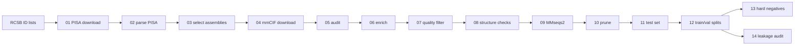

# BeastAffinity

A reproducible pipeline that turns a list of PDB entries into a curated,
non-redundant dataset of **protein–protein interfaces** with PISA energetics,
structure-quality metrics and homology-aware train / validation / test splits.

Starting from any set of IDs exported from the RCSB Advanced Search, it:

1. downloads the PISA interface analysis of every entry from PDBe,
2. keeps protein–protein interfaces as candidate chain pairs,
3. downloads only the biological-assembly mmCIF files those pairs need, plus their
   entry metadata (method, resolution, R-free) from the RCSB Data API,
4. adds sequence, coverage and experimental-quality metadata to every pair,
5. filters by quality, removes chains with non-standard residues and checks
   that every PISA interface has real atomic contacts,
6. clusters all chains with MMseqs2 at eight identity thresholds (connected
   components, so that cluster-based splits do not leak homologues),
7. prunes redundancy and builds a test set (C1/C2/C3) and cluster-aware train/val splits,
8. optionally adds **hard negatives**: chains of the same complex that are not in contact,
9. audits the homology leakage between training and test/validation sets.

## Pipeline

Python steps do the heavy extraction (downloads, JSON and mmCIF parsing,
clustering); R steps take the data-analysis decisions (filters, pruning, splits).

| Step | Script | What it does | Main output |
|---|---|---|---|
| 01 | `01_download_pisa.py` | Reads the ID lists; downloads PISA JSON from PDBe | `raw/pisa/` |
| 02 | `02_parse_pisa.py` | One row per protein pair in each PISA interface | `02_master_pisa.csv` |
| 03 | `03_select_assemblies.R` | Restricts to the ID list; lists the assemblies needed | `03_needed_pairs.csv` |
| 04 | `04_download_structures.py` | Downloads the needed assembly mmCIF files; entry metadata from the RCSB Data API | `raw/assemblies/`, `04_entry_metadata.csv` |
| 05 | `05_audit_downloads.py` | Checks that every needed file is on disk | `05_audit_downloads.json` |
| 06 | `06_enrich_mmcif.py` | Sequences, coverage, homo/hetero, method, resolution, R-free | `06_enriched.csv` |
| 07 | `07_quality_filter.R` | Exploratory analysis + quality filter + gold/silver tier | `07_quality_filtered.csv` |
| 08 | `08_check_structures.py` | Drops chains with non-standard amino acids and pairs without atomic contacts | `08_checked.csv` |
| 09 | `09_cluster_chains.py` | MMseqs2 chain clustering at 98–40 % identity (connected components) | `09_clustered.csv` |
| 10 | `10_prune_redundancy.R` | Exact-duplicate soft cap + pruning in `pair_cluster_98` | `10_pruned.csv` |
| 11 | `11_build_test_set.R` | Test set: C1 (train-like), C2 (new pairs), C3 (unseen proteins) | `processed/test.csv` |
| 12 | `12_trainval_splits.R` | Cluster-aware train/val splits and family weights | `processed/trainval_splits.csv`, `processed/validation.csv` |
| 13 | `13_hard_negatives.py` | Non-contacting chain pairs of the same assembly, assigned to splits | `processed/hard_negatives.csv` |
| 14 | `14_leakage_audit.py` | Homology leakage of each test bucket and of validation against training | `reports/14_leakage_audit.json` |

`analysis/clustering_stats.R` is an optional exploratory report on the clusters
(`snakemake --cores 1 clustering_stats`).



## Installation

```bash
conda env create -f environment.yml
conda activate beastaffinity
```

The environment provides Python 3.11, R 4.x (dplyr, tidyr, data.table, yaml),
MMseqs2 and Snakemake.

## Usage

1. Run a query in the [RCSB Advanced Search](https://www.rcsb.org/search/advanced),
   click **Download IDs** and put the `.txt` file(s) in `pdb_ids/`.
2. Review the parameters in `config/config.yaml` (every threshold lives there).
3. Run the pipeline from the repository root:

```bash
snakemake -n              # dry run: list the steps that would run
snakemake --cores 8       # run everything
```

Useful Snakemake commands:

```bash
snakemake --cores 8 --until quality_filter           # stop after step 07
snakemake --cores 8 --forcerun download_structures   # rerun a step (e.g. retry failed downloads)
snakemake --cores 8 --config cfg=config/test.yaml    # use another config file
snakemake --dag | dot -Tsvg > dag.svg                # draw the workflow
```

Snakemake only reruns what is missing or out of date: if you change a section
of the config (for instance `quality_filter`), the next run repeats that step
and everything downstream of it. Every script can also be run by hand from the
repository root, e.g. `python scripts/06_enrich_mmcif.py --config config/config.yaml`
or `Rscript scripts/07_quality_filter.R config/config.yaml`.

### Quick test

`config/test.yaml` runs the whole pipeline on the 1,500 IDs in `tests/pdb_ids/`
(about 0.5 GB of downloads, ~6 minutes) into `data_test/`:

```bash
snakemake --cores 8 --config cfg=config/test.yaml
```

## Choosing the parameters

Every threshold is in `config/config.yaml`. The defaults reproduce the
BeastAffinitySeq8 dataset, but most of them are a matter of what the dataset
is for; the notes below explain what each group means.

**PISA pre-filter (`pisa`, step 02).** PISA reports `interface_area` as the
solvent-accessible area buried *per side* (half of the total buried surface),
so 800 Ų means about 1,600 Ų buried in total, above the typical range of
crystal-packing contacts. `p_value` is PISA's ΔiG P-value: the probability of
finding a more hydrophobic patch of the same size by chance; values below 0.5
suggest an interaction-specific interface. PISA-lite does not provide the
complexation significance score (CSS) of classic PISA, so specificity relies
on area, P-value and solvation energy. These two values are only a pre-filter
(they decide which structures are downloaded); the final thresholds are set in
`quality_filter` and can only be stricter. Only the assemblies an entry has
today are used (`only_current_assemblies`): the PDBe dump can keep assemblies
removed in later revisions.

**Quality filter (`quality_filter`, step 07).** Experimental method, R-free,
optional maximum resolution, minimum coverage of both chains, chain length
range, interface area range and P-value. Method and resolution are often
already restricted by the RCSB query (the Seq8 dataset used X-ray structures
up to 3.0 Å); cryo-EM entries are excluded by design because they have no
R-free. `coverage_metric` chooses between `coverage` (resolved / SEQRES
residues) and `internal_coverage` (resolved residues between the first and the
last resolved one): with the latter, disordered expression tags and tails are
not penalised, only internal gaps. An optional cut on solvation density
(`solvation_energy / interface_area`) is available but disabled by default.
`max_chain_length` is often limited by the model you plan to train. Homo/hetero
pairs are defined by the same entity or a sequence identity of at least
`enrichment.homo_similarity`, measured on a global alignment over the shorter
chain, so a truncated construct of the same protein counts as homo.

**Structure checks (`special_residues`, `contacts`, step 08).** Chains with
non-standard amino acids other than the allowed ones are dropped. The default
is conservative: only the selenium variants used for phasing (MSE, SEM, SEC)
are allowed. In practice the excluded chains (about 1.5 %) carry cysteine
modifications that are usually crystallisation artefacts (CAS, CSO, CSX, CME,
CSS), catalytic or cofactor lysines (LLP, KCX), N-terminal modifications (PCA,
FME) or post-translational modifications (SEP, TPO, PTR, ALY, TYS); add any of
them to `allowed` if they are acceptable for your use. Every pair must also
have at least `min_residue_contacts` residue pairs with amino-acid heavy atoms
within `cutoff` Å; this catches PISA interfaces that cannot be mapped onto the
structure.

**Clustering (`clustering`, step 09).** Chains are clustered at eight
identity thresholds (98 to 40 %); the clusters define the pruning groups
(98 %), the validation splits (90, 80, 60 %), the C2 test buckets (pair
clusters at 70 and 80 %) and the C3 buckets (chain clusters at 40 and 50 %).
The default method, `connected_components`, runs one all-vs-all MMseqs2 search
and links two sequences when their identity is above the threshold with the
required alignment coverage; clusters are the connected components (single
linkage). This guarantees that no two sequences of different clusters are
similar above the threshold, so splits made by cluster do not leak homologues;
the price is that large families can merge into big clusters (at 40 %, the
largest component of the Seq8 dataset holds 7 % of the sequences). The
alternative `set_cover` (MMseqs2 `cluster`, used for BeastAffinitySeq8) only
guarantees that every member is similar to its representative: members of
different clusters can still be similar above the threshold, which left about
3 % of the Seq8 validation pairs and 3 % of its unseen-protein test chains with
a homologue in training. Other approaches can be preferable depending on the
question: greedy incremental clustering (CD-HIT), graph-partitioning methods
that balance split sizes while removing cross-split homology (GraphPart),
structure-based clustering (Foldseek, TM-score), which also catches remote
homologues below ~30 % sequence identity, or splits by domain classification
(CATH, SCOP, ECOD).

**Redundancy (`pruning`, step 10).** Many entries contain several copies of
the same complex (non-crystallographic symmetry, several assemblies), and close
homologues appear across entries. The step works in two stages:

1. *Identical sequence pairs* are capped, across the whole dataset, to the best
   `exact_K_homo` / `exact_K_heter` rows (ranked by coverage, P-value,
   interface area, R-free, resolution and solvation energy). In Seq8 this
   stage removed 92 % of the pruned rows: one sequence pair appeared 1,081 times.
2. *Pair clusters* (`pair_key`, by default `pair_cluster_98`: both chains at
   least 98 % identical) with more than `activate_n` rows are reduced to
   `K_redund_*` rows when their interface areas are almost identical (range
   within `area_range_pct_thr` % of the mean) or to `K_var_*` rows spread over
   interface-area bins otherwise.

Point mutants and variants with a few substitutions are different sequence
pairs, so the first stage keeps them, but they share a 98 % pair cluster, so
the second stage keeps only a few of them per complex. If you want mutant
series (e.g. to learn the effect of substitutions on the interface), raise
`activate_n` (a very large value disables the second stage) or the `K_*`
values; for a strictly non-redundant set, set every `K` to 1.
`compare_pair_cluster_95` additionally prints a broader pruning in
`pair_cluster_95` for comparison.

**Test set and splits (`test_set`, `splits`, steps 11–12).** C1 rows are
train-like, C2 rows are new pairings of known proteins (pair clusters at 70 and
80 %), C3 rows contain proteins unseen in training (chain clusters at 40 and
50 %). Train/validation splits are made by pair cluster, stratified by
homo/hetero, with a family weight of 1/√(cluster size).

**Hard negatives (`hard_negatives`, step 13).** Two protein chains of the
same biological assembly with no PISA interface between them. Homo pairs are
excluded by default (a copy of a protein not touching another copy usually
contradicts a homo interface elsewhere in the complex). A negative is dropped
if its pair of chain clusters (`conflict_level`) is in contact in any
downloaded assembly, if it fails the quality thresholds of step 07, if a chain
has forbidden residues or if the chains are closer than `min_distance` Å. One
negative is kept per entry and sequence pair, and at most `max_per_entry` per
entry, so that ribosomes and capsids do not dominate. Each negative inherits
the split of its proteins (test if any chain is in the test set or in a
held-out C3 cluster).

**Leakage audit (step 14).** Every chain of the test buckets and of the
validation set is searched against the training chains with the identity and
coverage criteria of step 09. `reports/14_leakage_audit.json` gives, for each
set, the number of leaks at its design threshold (chain level for the
unseen-protein C3 buckets, pair level for C2 and validation), and
`reports/14_leakage_by_threshold.tsv` the full picture at every threshold. With
connected components all of them should be zero.

## Outputs

All files are written under `data/` (configurable with `data_dir`):

```
data/
├── raw/         PISA JSON and assembly mmCIF files (gzipped), with download manifests
├── interim/     tables of steps 01–11
├── processed/   test.csv, trainval_splits.csv, validation.csv, hard_negatives.csv
├── reports/     audits, parse errors, quality-filter plots
└── logs/        one log per step
```

Disk space: about 25 KB of PISA JSON and 0.27 MB of mmCIF per assembly, i.e.
~0.5 GB for the 1,500-ID test and roughly 30 GB for a list of ~160,000 IDs.

## Troubleshooting

- **"Output … has older modification time than input … clock skew" (WSL2).**
  The WSL2 clock can jump back after the computer sleeps. Run the same
  `snakemake` command again; it resumes from the step that stopped.
- **Failed downloads.** Steps 01 and 04 report failed files in their manifests;
  `snakemake --cores 8 --forcerun download_structures` retries them.

## Data sources

- **RCSB PDB** — assembly mmCIF files (`files.rcsb.org`), the Data API
  (`data.rcsb.org`, current assemblies and entry metadata) and the Advanced Search.
  Burley et al., *Nucleic Acids Res.* (2023).
- **PDBe PISA** — interface and assembly analysis
  (`ftp.ebi.ac.uk/pub/databases/msd/pdb-assemblies-analysis`).
  Krissinel & Henrick, *J. Mol. Biol.* 372, 774–797 (2007).
- **MMseqs2** — Steinegger & Söding, *Nat. Biotechnol.* 35, 1026–1028 (2017).
- **Biopython** — Cock et al., *Bioinformatics* 25, 1422–1423 (2009).

## Roadmap

On 21 July 2027 the wwPDB switches to extended PDB IDs (`pdb_` + 8 characters)
and a reorganised archive. Version 2 will accept both ID formats and use the new
archive layout. See [docs/MIGRATION.md](docs/MIGRATION.md) for the history of the pipeline.
