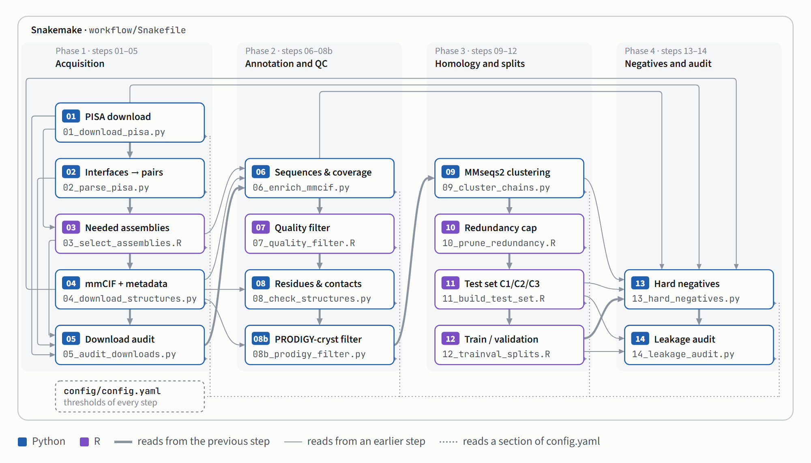

# PPI_PDB_Scraper

> **About this project.** PPI_PDB_Scraper is an independent, personal project.
> I conceived it and developed it by hand over 2025 and early 2026, to have a
> reliable source of protein–protein interface structures for training models
> related to protein function. Once the method was mature, I audited it in
> depth with Claude and rebuilt it as a reproducible Snakemake workflow, so that
> the whole dataset can be regenerated from a list of PDB IDs and a single
> configuration file. I am now sharing it with the community.

A reproducible methodology to scrape **protein–protein interfaces (PPIs) from the
Protein Data Bank** and turn them into a curated, non-redundant dataset for
machine learning. It combines PDBe-PISA interface energetics with structural
quality control, physicochemical filters, descriptive analysis, MMseqs2
homology clustering, leakage-free train / validation / test splits and hard
negatives. The whole workflow is orchestrated with Snakemake (Python + R) and
driven by a single configuration file.

Starting from any list of PDB IDs exported from the RCSB Advanced Search, it:

1. downloads the PISA interface analysis of every entry from PDBe and keeps the
   protein–protein interfaces as candidate chain pairs;
2. downloads only the biological-assembly mmCIF files those pairs need, plus
   entry metadata (method, resolution, R-free, release dates, revision),
   membrane and antibody annotations and UniProt accessions from the RCSB Data API;
3. annotates every pair with chain sequences, coverage, homomeric/heteromeric
   status and experimental quality, with descriptive statistics and plots;
4. applies **crystallographic and physicochemical QC** (method, R-free,
   coverage, chain length, buried interface area, PISA ΔiG P-value) and
   **structural QC** in the coordinates (non-standard residues, real atomic
   contacts, clashes);
5. removes small interfaces that **PRODIGY-cryst**, a classifier independent of
   PISA, calls crystal contacts;
6. clusters all chains with MMseqs2 at several identity thresholds (95–30 %)
   by connected components, so that cluster-based splits do not leak
   homologues;
7. caps redundant copies, builds a test set with the three classes of Park and
   Marcotte (C1 new pairs of seen proteins, C2 one unseen protein, C3 unseen
   proteins) and cluster-aware train/val splits with family weights;
8. adds **hard negatives** (chains of the same complex that are not in contact)
   and checks each of them against **IntAct**, dropping any with evidence of a
   direct interaction;
9. audits the homology leakage between training and every evaluation set.

Every curation decision, with its reason, precedents, effect and biases, is in
[docs/DECISIONS.md](docs/DECISIONS.md).

## A full run

Reference run of 10–11 November 2026 on 164,000 X-ray entries (resolution
≤ 3.0 Å), on a laptop under WSL2 (20 cores, 14 GB RAM):

| Stage | Result |
|---|---|
| PISA (steps 01–02) | 245,757 assemblies, 564,347 interfaces → **204,075 candidate pairs** from 69,580 entries |
| First assembly (step 03) | 155,899 pairs from 66,807 entries |
| Structures (step 04) | 66,807 assembly mmCIF files, 0 failed downloads |
| Quality filter (step 07) | 118,044 pairs (3,032 with a membrane-protein chain excluded) |
| Structure checks (step 08) | 109,825 pairs |
| Small interfaces (step 08b) | 4,385 of the 15,798 pairs below 1,000 Ų called crystal by PRODIGY-cryst and removed → 105,440 pairs (31,722 unique chain sequences) |
| Redundancy (step 10) | 43,710 pairs after the cap on identical sequence pairs |
| Final dataset | **39,747 train/val pairs** (35,354 / 4,393 in `split_c40`), **750 test pairs** (C1 150, C2 300, C3 300), **492 hard negatives**, from 32,989 entries |
| Leakage audit (step 14) | **0 leaks by sequence** in the 11 audited sets |
| PRODIGY-cryst (optional) | 98.7 % of the 40,479 scored final positives called biological (95.4 % without step 08b) |
| Time | about 2 h 20 min with the files already on disk (steps 01–07 58 min, 08b 29 min, the other steps of 08–14 about 52 min); PRODIGY-cryst annotation 55 min; independent leakage control about 1 h 20 min |
| Disk | `raw/` 27 GB (it still holds every assembly of the run of 2 November; about 20 GB for a fresh run), `interim/` 1.2 GB, `processed/` 96 MB |

A run from scratch also downloads the PISA files and the structures: in the
run of 2 November 2026 that took 6 h 03 min for PISA and 1 h 22 min for
93,029 assembly files (every assembly, the default then; the first assembly
only needs 66,807). In the final dataset 75.4 % of the train/val pairs are
*gold* (P-value < 0.2) and 79.6 % are homomeric.

## Pipeline

Python steps do the heavy extraction (downloads, JSON and mmCIF parsing,
geometry, clustering); R steps make the data-analysis decisions (filters,
pruning, splits).



*Each numbered step is a Snakemake rule with the script it runs; an arrow goes from a step to every step that reads one of its files, and the dotted lines mark the steps that read a section of `config/config.yaml`.*

| Step | Script | What it does | Main output |
|---|---|---|---|
| 01 | `01_download_pisa.py` | Reads the ID lists; downloads PISA JSON from PDBe | `raw/pisa/` |
| 02 | `02_parse_pisa.py` | One row per protein pair in each PISA interface | `02_master_pisa.csv` |
| 03 | `03_select_assemblies.R` | Restricts to the ID list and, by default, to the first assembly of each entry; lists the assemblies needed | `03_needed_pairs.csv` |
| 04 | `04_download_structures.py` | Downloads the needed assembly mmCIF files; entry and entity metadata from the RCSB Data API | `raw/assemblies/`, `04_entry_metadata.csv`, `04_entity_metadata.csv` |
| 05 | `05_audit_downloads.py` | Checks that every needed file is on disk | `05_audit_downloads.json` |
| 06 | `06_enrich_mmcif.py` | Sequences, coverage, homomeric/heteromeric, method, resolution, R-free | `06_enriched.csv` |
| 07 | `07_quality_filter.R` | Descriptive analysis + scope and quality filter + gold/silver tier | `07_quality_filtered.csv` |
| 08 | `08_check_structures.py` | Drops chains with non-standard amino acids and pairs without atomic contacts | `08_checked.csv` |
| 08b | `08b_prodigy_filter.py` | Drops the pairs below 1,000 Ų that PRODIGY-cryst calls crystal contacts (own environment; `prodigy.filter: false` skips it) | `08b_checked.csv` |
| 09 | `09_cluster_chains.py` | MMseqs2 chain clustering at 95–30 % identity (connected components) | `09_clustered.csv` |
| 10 | `10_prune_redundancy.R` | Cap on identical sequence pairs (optional pair-cluster pruning) | `10_pruned.csv` |
| 11 | `11_build_test_set.R` | Test set: C1 (new pairs), C2 (one unseen protein), C3 (unseen proteins) | `processed/test.csv` |
| 12 | `12_trainval_splits.R` | Cluster-aware train/val splits and family weights | `processed/trainval_splits.csv`, `processed/validation.csv` |
| 13 | `13_hard_negatives.py` | Non-contacting chain pairs of the same assembly, checked against IntAct and assigned to splits | `processed/hard_negatives.csv` |
| 14 | `14_leakage_audit.py` | Homology leakage of each test class, the validation sets and the test negatives | `reports/14_leakage_audit.json` |

Optional analyses (not run by default): `prodigy_cryst` annotates every final
positive with PRODIGY-cryst, `leakage_control` audits the splits with an
independent measure (see below) and `clustering_stats` reports on the clusters.

## Requirements and installation

Linux x86-64 (or WSL2 on Windows), [conda](https://conda-forge.org/download/)
or miniforge, about 20 GB of disk for the reference dataset (0.5 GB for the
quick test) and network access to PDBe and RCSB (and to IntAct for step 13).
R, MMseqs2 and Snakemake are installed by conda.

```bash
git clone https://github.com/marcos-bioinformatics/PPI_PDB_Scraper.git
cd PPI_PDB_Scraper
conda env create -f environment.yml
conda activate ppi_pdb_scraper
```

The environment provides Python 3.11, R ≥ 4.3 (dplyr, tidyr, data.table, yaml),
MMseqs2, Snakemake and graphviz. `environment.yml` gives version ranges;
`environment.lock.yml` gives the exact versions the reference run used
(`conda env create -f environment.lock.yml`), and every run records its
software versions in `reports/provenance.json`.

Step 08b runs PRODIGY-cryst, which needs Python 3.8 and scikit-learn 0.22, in a
second environment (or set `prodigy.filter: false` to skip it):

```bash
conda env create -f envs/prodigy_cryst.yml
conda run -n prodigy_cryst pip install --no-deps prodigy-cryst==1.0.1
```

The optional independent leakage control has its own environment too
(`conda env create -f envs/leakage_control.yml`).

## Usage

1. Run a query in the [RCSB Advanced Search](https://www.rcsb.org/search/advanced),
   click **Download IDs** and put the `.txt` file(s) in `pdb_ids/`. The query
   decides the scope of the dataset (method, resolution, date…). Write the query
   (its JSON file or URL) and the date in `scope.input_query` and
   `scope.input_query_date`: they are copied to `reports/provenance.json` with a
   checksum of every ID list. `pdb_ids/` holds the 17 lists of the reference run.
2. Review the parameters in `config/config.yaml` (every threshold lives there;
   [docs/METHODS.md](docs/METHODS.md) explains them).
3. Run the pipeline from the repository root:

```bash
snakemake -n              # dry run: list the steps that would run and why
snakemake --cores 8       # run everything
```

Useful Snakemake commands:

```bash
snakemake --cores 8 --until quality_filter            # stop after step 07
snakemake --cores 8 --forcerun download_structures    # rerun a step (e.g. retry failed downloads)
snakemake --cores 8 --config cfg=config/test.yaml     # use another config file
snakemake --cores 20 leakage_control                  # an optional analysis (a target goes before --config)
snakemake --cores 8 --touch --until check_structures  # mark steps 01-08 as up to date without running them
snakemake --dag | dot -Tsvg > dag.svg                 # draw the workflow
```

Snakemake only reruns what is missing or out of date. Each rule receives the
config sections it uses as `params` and declares its script (and the shared
`common.py` / `common.R`) as inputs, so changing a section of the config or
editing a script repeats that step and everything downstream of it. Editing
`scripts/common.py` therefore reruns the whole pipeline, downloads included;
after a change that does not affect the early steps, `snakemake --touch --until
<rule>` marks them as up to date. A config can inherit from another one with
`base: config/config.yaml`; `--config` only accepts `cfg=<file>`. Every script
can also be run by hand from the repository root, e.g.
`python scripts/06_enrich_mmcif.py --config config/config.yaml` or
`Rscript scripts/07_quality_filter.R config/config.yaml`.

### Quick test

`config/test.yaml` runs the whole pipeline on the 1,500 IDs in `tests/pdb_ids/`
(about 0.5 GB of downloads) into `data_test/`. It needs the `prodigy_cryst`
environment too.

```bash
snakemake --cores 8 --config cfg=config/test.yaml
python tests/check_outputs.py --config config/test.yaml   # consistency and leakage checks
```

Step 11 warns that C1 has fewer than the 10 requested pairs: the test IDs are
too few to fill it. A run from scratch takes about 10 minutes. `tests/check_outputs.py` runs 31 checks on the final tables (sizes,
duplicates, test/train overlap, lengths, contacts, the hard negatives, parse
errors, failed IntAct queries, the PRODIGY-cryst filter and the 11 leakage
sets) and fails if any of them does not hold.

## Clustering and leakage: a project-specific choice

How strictly training and evaluation data must be separated depends on what a
model has to generalise to, so these criteria are a choice of each project, not
a property of the data. The defaults follow common practice:
two chains are linked when MMseqs2 aligns them at the threshold identity with
an alignment that covers at least 90 % of either chain; clusters are the
connected components; the test classes and the `split_c40` validation are
separated at 40 % identity (the AlphaFold 3 low-homology level) and `split_c60`
at 60 %.

What the defaults guarantee: no evaluation chain or pair has a homologue in its
reference data *by this criterion* (step 14; `tests/check_outputs.py` fails
otherwise). What they do not: chains linked only through a shorter alignment, by
structure or below 30 % identity. `analysis/leakage_control.py` measures the
first kind with global alignments (EMBOSS needleall, as GraphPart) and two
identity definitions: *A*, identical positions over the alignment length
(GraphPart), and *B*, over the length of the evaluation chain (AlphaFold 3),
counted only with a significant local alignment. Leaks by A are chains that
share a long region with a reference chain, sometimes the same protein expressed
as another construct (expression tags, linkers, termini), which the 90 %
coverage rule does not link; leaks by B are mostly shared domains. In the
reference run the control finds, by A / B, 3 / 20 of the 435 C3 chains, 3 / 13
of the 292 unseen C2 chains and 43 / 95 of the 4,393 `split_c40` validation
pairs. The coverage is the main lever; these simulations were run on the data
before the selenomethionine fix of step 08b, which keeps 102 more pairs in the
reference run and gives it a different validation draw:

| `clustering.coverage` | Largest chain cluster at 40 % | C3 chains leaking, A / B | C2 unseen chains, A / B | `split_c40` validation pairs, A / B | Step 14 |
|---|---|---|---|---|---|
| 0.90 (default) | 5,065 sequences (16 %) | 6 / 22 of 431 | 3 / 21 of 286 | 9 / 84 of 3,989 | 0 leaks |
| 0.80 | 5,069 (16 %) | 2 / 9 of 429 | 2 / 9 of 289 | 0 / 225 of 4,007 | 2 rows (one pair) linked in step 14 but not in step 09 |
| 0.50 | 8,592 (27 %) | 1 / 4 of 430 | 0 / 9 of 289 | 0 / 31 of 4,009 | 0 leaks |

Lowering the coverage removes most construct leaks, but single linkage then
chains families together through multidomain proteins (at 0.50 the largest
training family at 40 % grows from 3,670 to 9,300 rows, and the test negatives
fall from 342 to 206), and more links sit at the edge of what the heuristic
MMseqs2 search finds (with 0.80, a homomeric validation pair at exactly 40 %
identity is linked in step 14 but was not in step 09). Leaks in validation
also depend on which families the random split sends there. The parameters to change are
`clustering.coverage`, `clustering.cov_mode`, `clustering.thresholds`,
`test_set.level`, `splits.schemes` and `hard_negatives.conflict_level`;
`snakemake leakage_control` then measures the result with the independent
criterion. [docs/METHODS.md](docs/METHODS.md) describes the clustering, the
test classes and the audit in detail.

## Outputs

All files are written under `data/` (configurable with `data_dir`):

```
data/
├── raw/         PISA JSON and assembly mmCIF files (gzipped), with download manifests
├── interim/     tables of steps 01–11
├── processed/   test.csv, trainval_splits.csv, validation.csv, hard_negatives.csv
├── reports/     audits, parse errors, quality-filter plots, provenance.json
└── logs/        one log per step
```

Each row of the final tables carries the PISA interface metrics, what was
measured in the structure, the entry metadata, the membrane, antibody and
UniProt annotations of each chain, the chain and pair cluster IDs at every
threshold, the test class or the split columns, the gold/silver `tier` and
`family_weight_c40`. [docs/COLUMNS.md](docs/COLUMNS.md) describes every column.

## Documentation

- [docs/METHODS.md](docs/METHODS.md): what each step does and what its parameters mean.
- [docs/DECISIONS.md](docs/DECISIONS.md): every curation decision, with its reason, precedents, effect and biases.
- [docs/COLUMNS.md](docs/COLUMNS.md): the columns of the final tables.
- [docs/MIGRATION.md](docs/MIGRATION.md): how this version relates to the working versions (Seq5–Seq8, 2025–2026) and the bugs fixed on the way.

## Known issues

- The homo filter of step 13 only removes identical sequences, not the
  `is_homo` definition of step 06 (the conflict filter usually catches the rest).
- The hard negatives come from few large complexes (35 % from proteasome and
  24 % from ribosome entries in the reference run; the 289 test negatives come
  from 77 families at 40 %, 54 % of them from these two kinds of complex) and
  none is homomeric: evaluate them per family and against heteromeric positives
  only. The IntAct check finds no contradiction rather than confirming them:
  almost all IntAct records for these pairs are expanded from n-ary complexes.
- C1 has 96 homomeric and 54 heteromeric pairs in the reference run, not 75 and
  75: only 54 heteromeric pair clusters leave both proteins with other partners
  in the train/validation pool, and homomeric pairs fill the class.
- A *seen* protein (test classes) is one with a row in the train/validation
  pool, so in a given split it may be only in validation. Validation is mostly
  not "known proteins with new partners": in `split_c40`, 77 % of the
  validation pairs have neither protein (chain cluster at 40 %) in training.
- In `split_c40`, one influenza hemagglutinin family of 852 rows makes up two
  thirds of the heteromeric validation rows: a cluster that does not fit the
  10 % target is still taken if that leaves the total closer to it.
- `is_homo` means the same entity or an aligned identity of at least 0.80, so
  it includes pairs of a protein and its truncated form (e.g. the p66–p51
  heterodimer of HIV-1 reverse transcriptase), and heteromeric pairs can share
  a UniProt accession (e.g. hemagglutinin HA1–HA2, cleaved from one precursor).
- The cap on identical sequence pairs (step 10) does not look at the
  interface: of the 1,839 sequence pairs with interfaces of different area in
  one entry (95 % homomeric), 1,279 keep rows of only one of them.
- The optional PRODIGY-cryst annotation does not score pairs with a
  selenocysteine (16 in the reference run) or a position modelled both as
  selenomethionine and methionine (1).
- Steps 01–04 query live services: a rerun of those steps can download updated
  PISA files and metadata while keeping older mmCIF files. To freeze a dataset,
  keep `data/raw/` and `data/interim/` and do not rerun steps 01–04.

## Troubleshooting

- **"Output … has older modification time than input … clock skew" (WSL2).**
  The WSL2 clock can jump back after the computer sleeps. Run the same
  `snakemake` command again; it resumes from the step that stopped.
- **Failed downloads.** Each file is retried `download_retries` times. Steps 01
  and 04 stop if more than `max_failed_fraction` of the files still fail (run
  the same command again to retry them; files already on disk are kept) and
  report the remaining failures in their manifests.
- **Stopping a run.** On SIGTERM, Snakemake lets the running job finish (which
  can take hours during a download) and exits without losing anything; Ctrl-C
  stops at once and removes the incomplete outputs of that step.

## Data sources and terms of use

The pipeline downloads data; the datasets it builds keep the terms of their
sources.

- **PDB** (RCSB PDB: assembly mmCIF files, Data API, Advanced Search) — data
  under [CC0 1.0](https://www.wwpdb.org/about/usage-policies). Burley et al.,
  *Nucleic Acids Res.* (2023).
- **PDBe PISA** (interface and assembly analysis, PISA-lite bulk files) — PDBe
  data are public under [CC0](https://www.ebi.ac.uk/pdbe/about/public-data-access-statement),
  with the [EMBL-EBI terms of use](https://www.ebi.ac.uk/about/terms-of-use).
  Krissinel & Henrick, *J. Mol. Biol.* 372, 774–797 (2007).
- **IntAct** (PSICQUIC web service, step 13) — data under CC BY 4.0
  ([IMEx](https://imex-consortium.github.io/about/)): cite IntAct when you use
  the `intact_*` columns. del Toro et al., *Nucleic Acids Res.* 50, D648–D653 (2022).
- **SIFTS** (UniProt accessions, through RCSB), **PDBTM** and **SAbDab**
  (membrane and antibody annotations, through RCSB).

Software and methods: MMseqs2 (Steinegger & Söding, *Nat. Biotechnol.* 2017),
PRODIGY-cryst (Elez et al., *BMC Bioinformatics* 2018; Jiménez-García et al.,
*Bioinformatics* 2019), Biopython (Cock et al., *Bioinformatics* 2009),
Snakemake (Mölder et al., *F1000Research* 2021), and for the optional control
EMBOSS (Rice et al., *Trends Genet.* 2000) and parasail (Daily, *BMC
Bioinformatics* 2016). The test classes follow Park and Marcotte (*Nat. Methods*
2012). [docs/DECISIONS.md](docs/DECISIONS.md) lists every reference.

## Roadmap

On 21 July 2027 the wwPDB switches to extended PDB IDs (`pdb_` + 8 characters)
and a reorganised archive. Version 2 will accept both ID formats and use the new
archive layout.

## Citation, license and contact

If you use PPI_PDB_Scraper, please cite it as described in
[CITATION.cff](CITATION.cff) (GitHub shows it under *Cite this repository*).
The code is released under the [MIT License](LICENSE). Questions and bug
reports: [GitHub issues](https://github.com/marcos-bioinformatics/PPI_PDB_Scraper/issues).
